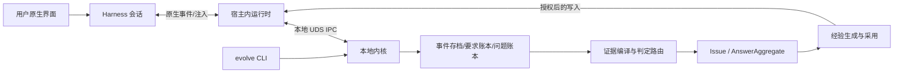

# evoplug

evoplug 是一个面向 coding harness 的本地外挂插件。它不替换宿主，而是挂在宿主自带的扩展入口上：把多轮对话里的用户要求和实际产物分别留档，按具体问题取证、核对约束、纠正偏差，再把可复用的经验留给后续任务。用户仍然在宿主原生界面里工作。目前适配 Pi、oh-my-pi、Step Code、Codex、OpenCode、OpenHands SDK 和 Claude Code 七家宿主，许可证为 Apache-2.0。

## 当前状态

项目还在 preview 试用阶段。这一阶段的重点是验证机制是否跑得通、失败时是否足够明确，先不追求稳定。CLI 参数、配置键、存储 schema 和默认策略都会继续调整，暂不承诺向后兼容，也可能存在问题。请先不要用在生产环境的关键任务上；试用时建议指定独立的 home 目录，并在挂载到宿主之前备份宿主配置，方便随时撤回。

论文即将开放，届时会一并给出设计推导、实验设置和效果数据。仓库里的设计文档、测试套件和验证材料整理之后陆续放出，目前还没有随代码发布。

另外需要说清楚一点：项目只承诺已经实现的机制和失败语义，不承诺效果。没有拿到证据的能力一律记为 `unknown`，fixture 断言和宿主自报都不能把它提升成已验证。

## 设计

运行时分成宿主内的薄运行时和本地内核进程两部分。宿主侧运行时随 adapter 分发，跟着宿主进程加载，只做三件事：按字节采集原生事件和原始载荷，在 hook 边界把投递内容注入回去，通过本地 UDS 和内核通信。归一化、事件身份、ID 分配、写数据库都留在内核里，运行时自己不做决定，也不读宿主凭据。

内核（`apps/kernel`）管输入边界、任务与问题账本、队列、预算、取消、幂等和配置版本。问题出现后，证据编译流程负责定位、拆题、取证、估算预算和校验引用；判定不下来时可以交给可选的 semantic backend，但它的输出只作 shadow，独立事实要另行验证。之后进入复盘：候选生成、diff、采用、试用、验证、停用分阶段执行，回滚只撤销版本，不撤销已经发生的业务动作。写回宿主的动作要先取得授权，approval、grant、egress、replay 各自管一段。

持久化用 SQLite 加 journal，进程崩溃后按 journal 帧重放，恢复到可信前缀。改动类命令都带 `--idempotency-key`，结果未知时不会重发。状态全部落在本地 home 目录，home 权限 `0700`，socket 和 token 权限 `0600`，进程间只走本地 UDS，默认不开放网络端口。



## 仓库结构

| 路径 | 内容 |
|---|---|
| `apps/kernel` | 内核服务进程，`evolve serve` 的入口 |
| `apps/cli` | `evolve` CLI，构建产物为 `apps/cli/dist/main.js` |
| `packages/*` | 领域包，包括 `core`、`ledger`、`evidence`、`review`、`budget`、`auth`、`egress`、`replay`、`delivery`、`storage`、`ipc`、`host-runtime` 等 |
| `adapters/*` | 七家宿主 adapter，含事件归一化、能力声明、探针规则和 runtime 入口 |
| `schemas/` | 契约 JSON Schema，经 codegen 生成 TypeScript 类型和校验器 |
| `migrations/` | 各域的 SQLite 迁移 |
| `tools/` | 构建与校验工具，含 schema codegen、依赖边界检查、kernel bundle、runtime artifact、adapter manifest、migrate |

## 安装

需要 Node `24.22.x`（见 `.node-version`）和 pnpm `12.14.0`。

```sh
corepack enable                # 或者自行安装 pnpm 12.14.0
pnpm install --frozen-lockfile
pnpm build                     # schema 校验 + tsc -b + kernel 入口打包
```

## 快速开始

```sh
HOME_DIR="$HOME/.evoplug"

# 初始化 home：schema、数据库和 IPC 运行时
node apps/cli/dist/main.js init --non-interactive --home "$HOME_DIR"

# 生成宿主内运行时并挂载
node tools/runtime-artifact/cli.mjs --host pi \
  --adapter-package adapters/pi --entry adapters/pi/runtime/entry.ts --out dist/runtime/pi
node apps/cli/dist/main.js attach pi --home "$HOME_DIR" --artifact-dir dist/runtime/pi

# 启动内核，前台运行，收到 SIGTERM 退出
node apps/cli/dist/main.js serve --home "$HOME_DIR"

# 另开一个终端看状态和自检结果
node apps/cli/dist/main.js status --home "$HOME_DIR"
node apps/cli/dist/main.js doctor --home "$HOME_DIR"
```

`attach` 和 `detach` 要写 home 里的文件，需要独占锁，所以得在 `serve` 停着的时候执行。其他宿主把 `pi` 换成对应 id（`claude-code`、`codex`、`opencode`、`oh-my-pi`、`step-code`、`openhands-sdk`），其中 `openhands-sdk` 还需要宿主环境里的薄 Python glue。`--home` 省略时依次取 `$EVOPLUG_HOME` 和 `~/.evoplug`；加 `--json` 会输出单个 `rsi.cli/1` 结果对象，便于脚本处理。

没有注入 Jev transport 和 generation port 时，`serve` 日志里会出现 `kernel.jev_transport_blocked` 和 `kernel.review_generation_disabled`，对应的投递和生成保持 fail-closed。这是当前的预期状态，不是启动失败。

## 常用命令

| 分组 | 命令 |
|---|---|
| 生命周期 | `init`、`configure`、`install`、`uninstall`、`serve`、`status`、`doctor` |
| 宿主接入 | `attach <host>`、`detach <host>` |
| 复盘与经验 | `review`、`skills diff`、`skills adopt`、`skills revoke`、`skills resolve` |
| 授权 | `grant issue`、`grant revoke`、`grant list`、`install approve/revoke/approval`、`egress approve` |
| 重放 | `replay create`、`approve`、`revoke`、`reject`、`reconcile`、`execute`、`result` |
| 数据 | `session fork`、`session resume`、`gc`、`export`、`import` |

具体参数以 `node apps/cli/dist/main.js --help` 或 `evolve <command> --help` 为准。

## 开发

```sh
pnpm schema:check       # schema 和生成代码是否一致
pnpm schema:check:ddl   # DDL 和 schema 是否一致
pnpm lint:boundaries    # workspace 依赖方向与边界
pnpm adapter:manifest   # 七家 adapter 的 manifest 指纹
pnpm typecheck
pnpm build
```

测试套件、证据材料和设计文档暂未随仓库发布，所以 `pnpm check` 里的 `test:unit` 还得先拿到测试目录才能跑。

## 已知限制

只在本机工作，不会自己进入远程机器、容器或云环境。能力按宿主版本和运行模式分别记录，同一宿主不同版本、不同配置空间下的结论不能互相替代。证据不足时会直接返回带错误码的 typed 结果并停下，不会猜着放行。问题或建议可以走仓库 Issue。
