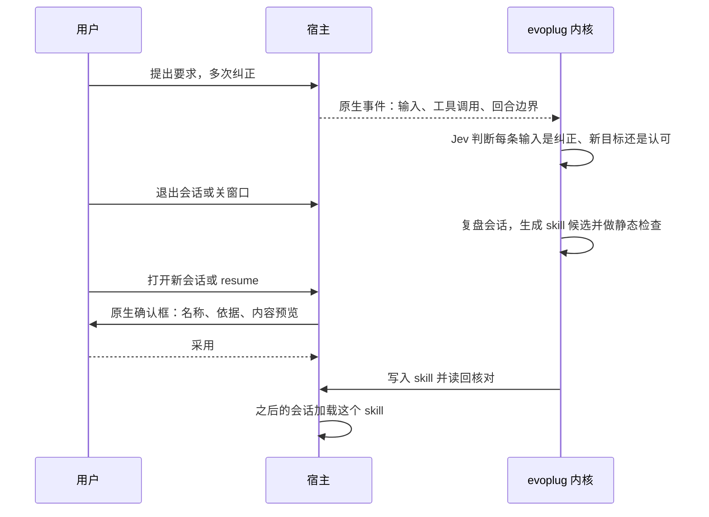
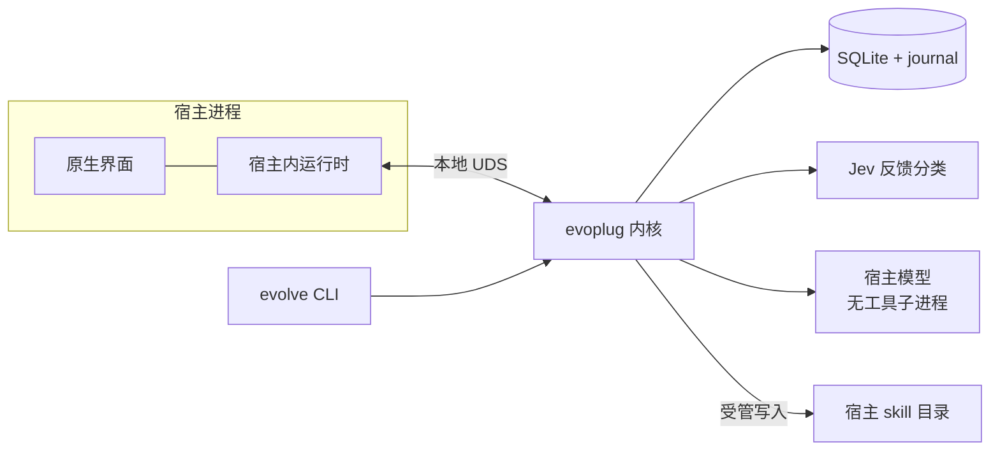

# evoplug

evoplug 让 coding agent 从用户的纠正里学会做事的方法。它以插件形式挂在宿主上，用户照常在宿主里对话。会话中用户提出的要求和纠正都会被记录下来。会话结束后，evoplug 在后台复盘，把反复出现的纠正整理成 skill。下一次会话开始时，宿主自己的界面会询问用户是否采用这个 skill；采用后，之后的会话就会加载它。

目前支持七个宿主：Pi、oh-my-pi、Step Code、OpenCode、OpenHands SDK、Claude Code、Codex。最新版本是 `0.1.0-alpha.1`，属于 preview。许可证为 Apache-2.0。

> 论文即将开放，敬请期待。

## 一次完整的闭环



1. **记录。** 宿主内的运行时把原生事件原样交给内核，包括用户输入、工具调用和回合边界。每条用户输入都交给 Jev 分类，判断它是纠正、新目标还是对结果的认可。
2. **复盘。** 会话结束时开始复盘：宿主发出结束事件，或者宿主进程消失、会话租约过期，都算会话结束。上一次复盘之后出现了新的纠正，才会再次复盘。快照截到最后一个稳定边界，没跑完的回合不计入。生成用的是宿主自己的模型，以无工具的子进程运行，输入是冻结的证据快照和已有 skill 的正文，同一流程已有 skill 时，生成器输出对它的更新。
3. **检查。** 候选必须通过静态检查才进入待确认队列，包括格式、文件头、目标路径，以及正文和证据里是否含有凭据。发给生成模型的证据也先经过出口过滤，带凭据的片段会被标为 secret 并剔除。
4. **确认。** 下一次交互会话开始时，宿主弹出原生确认框，展示 skill 的名称与用途、新建还是更新、触发复盘的纠正原话，以及内容预览。在新会话里，选项是「采用 / 拒绝」；resume 产生候选的那个会话时，选项是「采用 / 还没做完 / 内容不对」。确认框弹出后 300 ms 内收到的按键不算回答，这样提交输入时多按的回车不会替用户做决定。
5. **写入。** 采用后，内核把 skill 写进宿主原生的 skill 目录，读回核对哈希，下一次会话开始生效。`evolve skills disable` 停止加载，`evolve skills revoke` 彻底撤回，用户自己写的文件不受影响。

## 架构



**宿主内运行时**随 adapter 分发，由宿主进程加载。它负责三件事：采集原生事件、在 hook 边界上投递确认框、通过本机 UDS 与内核通信。事件归一化、ID 分配和所有写入都在内核里完成。

**内核**是唯一写数据库的进程。它负责输入记录、反馈分类、复盘队列、候选生命周期、授权和受管写入。数据存放在 SQLite 中，所有写入先进 journal 再投影到数据库。进程崩溃后，内核按 journal 重放到可信的前缀；如果某一帧投影失败，内核会停止后续写入，等用户重启后再恢复。

**adapter** 描述每个宿主的差异，包括事件格式、确认通道、skill 目录、生成命令和兼容的版本区间。attach 时，内核把运行时产物的实现哈希和 adapter 源码比对，宿主版本不在兼容区间时，能力保持 unknown。

| 宿主 | 兼容版本 | 确认通道 | skill 目录 |
|---|---|---|---|
| Pi | `>=1.2.0 <2.0.0` | 原生对话框 `ctx.ui.select` | `<agent>/skills/evoplug/` |
| oh-my-pi | `>=18.12.3 <19.0.0` | 原生对话框 | `<agent>/skills/` |
| Step Code | `>=0.1.5 <0.2.0` | 原生对话框 | `<agent>/skills/evoplug/` |
| OpenCode | `>=2.1.4 <3.0.0` | TUI 插件对话框 | `$XDG_CONFIG_HOME/opencode/skills/evoplug/` |
| OpenHands SDK | `>=1.56.0 <2.0.0` | 无，候选停在待确认 | `$OH_PERSISTENCE_DIR/skills/` |
| Claude Code | `>=2.1.304 <2.2.0` | MCP elicitation | `$CLAUDE_CONFIG_DIR/plugins/evoplug/skills/` |
| Codex | `>=0.160.1 <0.170.0` | 宿主空闲时的 MCP elicitation | `$CODEX_HOME/skills/evoplug/` |

本版只生成 skill。memory 与 instructions 区块、语义判定、配置自调优、主动重放四个子系统的代码已经在仓库里，分别由 `managed_blocks`、`semantic_judge`、`config_autotune`、`active_replay` 四个开关控制，默认关闭。

## 安装

从 [Releases](https://github.com/BingoResearch/evoplug/releases) 下载对应宿主的包 `evoplug-0.1.0-alpha.1-<host>.tar.gz`。运行需要 Node `24.22.x`。

```sh
tar -xzf evoplug-0.1.0-alpha.1-pi.tar.gz && cd evoplug-0.1.0-alpha.1-pi
export EVOPLUG_HOME="$HOME/.evoplug"
export JEV_TOKEN='<OpenRouter key>'

bin/evolve init --non-interactive
bin/evolve attach pi --artifact-dir runtime/pi --mode interactive
bin/evolve configure jev --endpoint https://openrouter.ai/api/v1/chat/completions \
  --model openai/gpt-4.1-nano --credential-env JEV_TOKEN \
  --request-max-tokens 16384 --question-max-tokens 8192
bin/evolve configure generation --host pi --credential-env <宿主凭据变量>
bin/evolve serve --jev-credential-env JEV_TOKEN --jev-allowed-host openrouter.ai
```

`serve` 启动后照常打开宿主即可。另开一个终端，`bin/evolve status` 查看各项能力，`bin/evolve skills pending` 查看待确认的候选。

每个宿主的环境变量、attach 写入位置、退出方式与复盘时机、回滚步骤，见 [安装与人工测试说明](docs/evoplug-安装说明-2026-11-18.md)。Jev 的配置项见 [Jev 配置](docs/evoplug-Jev配置-2026-11-17.md)。

## 从源码构建

需要 Node `24.22.x` 与 pnpm `12.14.0`。

```sh
corepack enable
pnpm install --frozen-lockfile
pnpm build
node tools/runtime-artifact/cli.mjs --single-file --host pi \
  --adapter-package adapters/pi --entry adapters/pi/runtime/entry.ts \
  --out dist/runtime/pi --force --mode interactive --config-space user
node tools/release-pack/cli.mjs --version 0.1.0-alpha.1 --out release/
```

CLI 入口是 `apps/cli/dist/main.js`，内核入口是 `apps/kernel/dist/main.js`。其他宿主的产物参数见安装说明第 7 节。

| 路径 | 内容 |
|---|---|
| `apps/kernel` | 内核进程，`evolve serve` 的入口 |
| `apps/cli` | `evolve` 命令行 |
| `packages/*` | 领域包：`core`、`ledger`、`evidence`、`review`、`auth`、`egress`、`storage`、`ipc`、`host-runtime` 等 |
| `adapters/*` | 七个宿主的 adapter 与运行时入口 |
| `schemas/` | 契约 JSON Schema，由 codegen 生成类型与校验器 |
| `migrations/` | SQLite 迁移 |
| `tools/` | schema codegen、依赖边界检查、kernel 打包、运行时产物、release 打包 |

## 常用命令

| 用途 | 命令 |
|---|---|
| 生命周期 | `init`、`configure jev`、`configure generation`、`serve`、`status`、`doctor` |
| 宿主接入 | `attach <host>`、`detach <host>` |
| skill | `skills pending`、`skills show`、`skills ask`、`skills disable`、`skills revoke` |
| 数据 | `export`、`import`、`gc` |

完整参数见 `evolve --help`。
