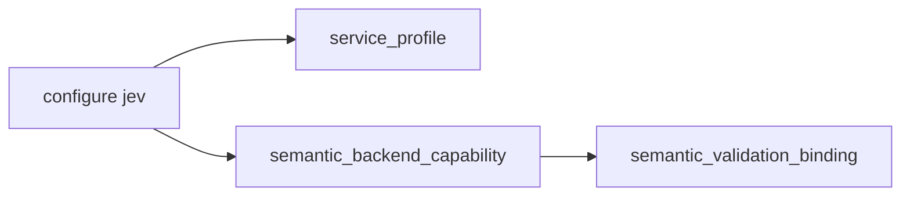

# evoplug Jev 配置（2026-11-17）

本文说明 `evolve configure jev` 的用户输入与它写入的持久化结构。凭据只登记环境变量名，配置文件不保存凭据值。

## 1 命令

```sh
evolve configure jev --endpoint https://openrouter.ai --model <model-id> --credential-env JEV_TOKEN
```

| 参数 | 必填 | 说明 |
|---|---|---|
| `--endpoint` | 是 | Jev 服务基址，必须是 `http` 或 `https` URL。`openrouter*` 主机记为 `provider=openrouter`，其余记为 `provider=typesafe`。 |
| `--model` | 是 | 请求模型与期望返回模型。`model_kind` 固定为 `fixed`。 |
| `--credential-env` | 是 | 环境变量名，写入 `credential_ref=env:<ENV>`。值本身不读取、不落盘、不打印；配置期间只在探测请求头里使用。 |
| `--request-max-tokens` | 否 | 显式请求上限。提供时覆盖探测值。 |
| `--question-max-tokens` | 否 | 显式问题上限，不得大于请求上限。 |
| `--skip-probe` | 否 | 跳过 provider metadata 探测。此时必须提供两个显式上限，且结论仍会因 `endpoint_unverified` 被 evidence 层判 blocked。 |

不带路径的 endpoint 使用默认路由 `/api/v1/messages`；带路径时保留该路径。

默认执行 provider metadata 探测：OpenRouter 请求 `GET <base_url>/api/v1/models`，其他 provider 请求 `GET <base_url>/models`。探测响应中匹配到请求模型时，从 `context_length` 与 `top_provider.max_completion_tokens` 推导上限（请求上限取 `min(max_completion_tokens, 8192)`，问题上限取 `min(request, 2048)`）；匹配不到时需要显式上限，否则命令直接失败并说明缺哪个参数，不会写入一个必然 blocked 的 profile。

探测响应的规范化 JSON 写入 CAS，并登记到 `blob` 表；同一个响应重复配置得到相同的 blob 与 profile，命令返回 `status=existing`，不会与已有 capability 行冲突。

高级入口 `evolve configure --jev-input FILE` 仍然可用，它直接读取一份 JSON 输入。命令表面（`--endpoint/--model/--credential-env`）生成同一组 `profile` 与 `capability` 结构。

## 2 写入内容



| 字段 | 探测成功时 | `--skip-probe` 时 |
|---|---|---|
| `profile.credential_ref` | `env:<ENV>` | `env:<ENV>` |
| `profile.limits.source` | `provider_metadata` | `unknown` |
| `profile.limits.source_refs` | 探测响应 blob | 空数组 |
| `profile.long_context.supported` | 按 `context_length >= 131072` 记 `yes`/`no` | `unknown` |
| `profile.h_evidence_refs` | 探测响应 blob | 空数组 |
| `capability.transport_status` | `verified` | `unknown` |
| `capability.semantic_competence` | 空数组（没有标定实验） | 空数组 |

`acceptance` 在探测成功时为 `eligible`；`--skip-probe` 时返回 `acceptance` 与 `acceptance_reasons`，提示 blocked 原因。命令不会把未验证的事实写成 verified。

`serve` 的 `--jev-credential-ref` 与 profile 的 `env:<ENV>` 可以是两种写法：凭据解析器同时接受显式 ref 和 `env:<NAME>`。因此下面这条等价于配置时写的 `env:JEV_TOKEN`：

```sh
evolve serve --jev-credential-env JEV_TOKEN --jev-credential-ref cred:openrouter-jev --jev-allowed-host openrouter.ai
```

若返回 `E_REVIEW_BACKEND_AUTH` / `credential_unavailable`，先确认 serve 进程环境里存在配置时登记的环境变量。

## 3 模板

```json
{
  "profile": {
    "provider": "openrouter",
    "base_url": "https://openrouter.ai",
    "route": "/api/v1/messages",
    "requested_model": "<model-id>",
    "expected_returned_model": "<model-id>",
    "model_kind": "fixed",
    "limits": {
      "request_max_tokens": null,
      "question_max_tokens": null,
      "source": "unknown",
      "source_refs": []
    },
    "long_context": { "supported": "unknown", "source_refs": [] },
    "official_precision_policy": "none",
    "observed_wire_precision": null,
    "precision_contract": "none_published",
    "observed_failures": [],
    "credential_ref": "env:JEV_TOKEN",
    "h_evidence_refs": []
  },
  "capability": {
    "backend_kind": "jev_typed",
    "implementation_id": "openrouter:<model-id>",
    "implementation_version": "configure/1",
    "method": {
      "schema_version": "rsi.method_ref/1",
      "method_id": "method:jev",
      "method_version": "1",
      "rule_version": "1"
    },
    "scope": {
      "schema_version": "rsi.semantic_scope/1",
      "question_classes": ["behavior_relation"],
      "issue_types": ["missing_requirement"],
      "state_profiles": ["progress_issue"],
      "evidence_kinds": ["source_excerpt"]
    },
    "transport_status": "unknown",
    "semantic_competence": [],
    "limits": {
      "state_supported": true,
      "max_questions": 8,
      "max_evidence_items": 32,
      "max_state_bytes": 64000,
      "max_request_bytes": 512000,
      "max_response_bytes": 256000
    },
    "source_refs": []
  }
}
```

## 4 生成与确认

```sh
evolve configure generation --host pi --credential-env PI_TOKEN
evolve configure show
```

`configure generation` 写 `review_backend`：`backend_id` 为宿主 id，`secret_ref=env:<ENV>`，`model` 可选。省略 `--model` 时，生成子进程不传模型参数，宿主 CLI 使用该宿主当前会话的默认 provider 与默认模型；命令输出用 `generation_model: "host_default"` 与 `generation_model_source: "host_session_default"` 标明，显式指定时标为 `explicit`。生成模型需要能稳定输出结构化 JSON（`rsi.generator_protocol/1` JSON Lines）；协议或 schema 失败时附首个错误重试一次，仍失败则复盘以 `E_UPSTREAM`、原因 `generation_output_invalid` 结束。`configure show` 只读打印当前配置，不读取凭据值。

`evolve serve` 启动时在日志中逐项列出 Jev、生成、确认三类状态，并给出下一步命令。Jev 或生成未配置时，状态为 `blocked`，`next_steps` 给出上面的配置命令；确认通道未建立时，提示在宿主交互会话中完成一次确认。
