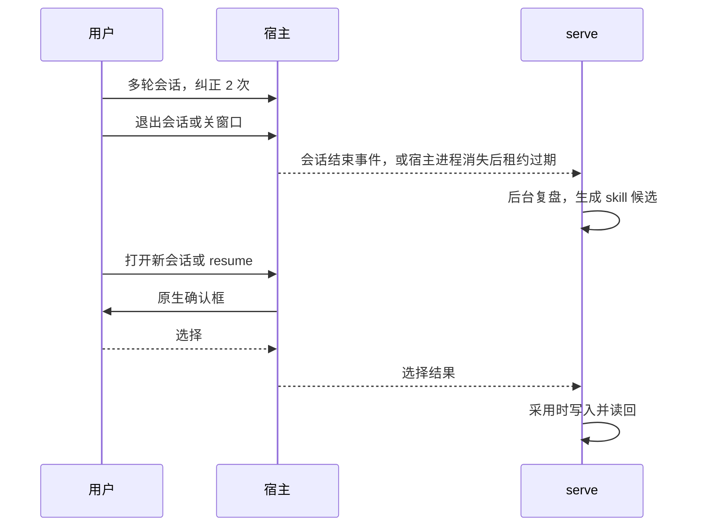

# evoplug 安装与人工测试：源码版 2026-11-20


下面的命令覆盖从源码构建到回滚，可在本机逐条直接执行，不依赖 pnpm。Node 24.22 由 `scripts/with-toolchain.sh` 注入 PATH。

约定：

- `<REPO>` 是仓库根目录。
- `<EVO_HOME>` 是 evoplug 产品 home（主目录），对应环境变量 `EVOPLUG_HOME`，例如 `/tmp/evoplug-manual/evoplug-home`。
- `<ARTIFACT>` 是宿主运行时产物的输出目录，例如 `/tmp/evoplug-artifact-pi`。
- `<HOSTS>` 是宿主安装根目录，位于真实用户主目录下的 `.local/share/evoplug-hosts`。隔离环境改过 `HOME`，引用时写绝对路径。
- `<AGENT>` 是宿主 agent（智能体）目录，即下面 `PI_CODING_AGENT_DIR` 或 `STEP_CODING_AGENT_DIR` 指向的目录。
- 凭据一律只通过环境变量传递，文档里只写变量名。
- 下文 `evolve` 指 `node apps/cli/dist/main.js`，需要工具链时前置 `scripts/with-toolchain.sh`。

## 1 构建

```sh
cd <REPO>
scripts/with-toolchain.sh node tools/schema-codegen/cli.mjs --check
scripts/with-toolchain.sh npx tsc -b tsconfig.build.json
scripts/with-toolchain.sh node tools/kernel-bundle/cli.mjs
```

CLI 入口是 `apps/cli/dist/main.js`，内核入口是 `apps/kernel/dist/main.js`。下面的命令都使用绝对路径，或先 `cd <REPO>`。

构建宿主运行时产物。以 Pi 为例：

```sh
scripts/with-toolchain.sh node tools/runtime-artifact/cli.mjs \
  --single-file \
  --host pi \
  --adapter-package adapters/pi \
  --entry adapters/pi/runtime/entry.ts \
  --out <ARTIFACT> \
  --force --mode interactive --config-space user
```

其他宿主把 `--host`、`--adapter-package`、`--entry` 换成第 7 节对应宿主的产物参数。运行时产物必须与当前 adapter（适配器）源码同时构建；adapter 的 `implementation_hash` 变化后，旧产物在 `attach` 阶段返回 `E_ARTIFACT_MISMATCH`。

## 2 隔离环境

人工测试与自动化测试都使用独立目录，避免写入真实宿主配置。每个终端先设置：

```sh
export EVO_ROOT=/tmp/evoplug-manual
export HOME=$EVO_ROOT/host-home
export TMPDIR=$EVO_ROOT/tmp
export EVOPLUG_HOME=$EVO_ROOT/evoplug-home
mkdir -p "$HOME" "$TMPDIR" "$EVOPLUG_HOME"
```

再按宿主补变量：

| 宿主 | 必设变量 | 说明 |
|---|---|---|
| Pi | `PI_CODING_AGENT_DIR=$EVO_ROOT/agent` | Pi 的 agent 目录 |
| oh-my-pi | `PI_CODING_AGENT_DIR=$EVO_ROOT/omp-agent`，`PATH=<HOSTS>/bun/bin:$PATH` | 需要 Bun |
| Step Code | `STEP_CODING_AGENT_DIR=$EVO_ROOT/step-agent` | Step 的 agent 目录 |
| OpenCode | `XDG_CONFIG_HOME=$EVO_ROOT/xdg` | 插件与配置根 |
| OpenHands SDK | `OH_PERSISTENCE_DIR=$EVO_ROOT/openhands`，`EVOPLUG_OPENHANDS_PYTHON=<HOSTS>/openhands/bin/python` | Python 解释器 |

宿主进程、`attach`、`serve` 必须使用同一组变量。`HOME` 改变后，宿主的登录态需要重新复制或重新登录；不要把真实凭据值写进本文或配置文件。

## 3 初始化、接入与配置

```sh
scripts/with-toolchain.sh node apps/cli/dist/main.js init --non-interactive --home "$EVOPLUG_HOME"

scripts/with-toolchain.sh node apps/cli/dist/main.js attach pi \
  --artifact-dir <ARTIFACT> --mode interactive --home "$EVOPLUG_HOME"

export JEV_TOKEN='<JEV_TOKEN>'
export HOST_TOKEN='<HOST_TOKEN>'

scripts/with-toolchain.sh node apps/cli/dist/main.js configure jev \
  --endpoint <JEV_ENDPOINT> --model <JEV_MODEL> \
  --credential-env JEV_TOKEN --request-max-tokens 16384 --question-max-tokens 8192 \
  --home "$EVOPLUG_HOME"

scripts/with-toolchain.sh node apps/cli/dist/main.js configure generation \
  --host pi --credential-env HOST_TOKEN --pricing-free \
  --home "$EVOPLUG_HOME"
```

`attach` 会按调用方的环境解析受管写入目录，并登记宿主环境快照。之后读版本、跑生成探针、启动复盘生成子进程，都只用这份快照，不用内核进程环境。其他宿主把 `attach` 和 `configure generation` 的 `pi` 换成第 7 节列出的宿主 id。

`configure generation` 的 `--model` 可省略，省略时使用宿主默认模型。`--pricing-free` 只用于价格为零的本地或自建模型；付费模型不要加这个参数。

`<JEV_MODEL>` 建议用 `openai/gpt-4.1-nano`，`<JEV_ENDPOINT>` 用 `https://openrouter.ai/api/v1/chat/completions`，serve 相应加 `--jev-allowed-host openrouter.ai`。OpenRouter 上的免费模型在 2026-11-22 的实测中都没有同时做到 schema 全部合法与 15 s 内返回，选型数据见第 10.4 节。

Jev 的 `--question-max-tokens` 要覆盖 judge state（判定状态）、问题本身与输出预留。本机实测一个 `goal_change` 问题的用量约 2,968 token；沿用 2048 这个上限会让 shard（分片）因 `exceeds_question` 被拒，建议 `--question-max-tokens 8192`、`--request-max-tokens 16384`。

四个开关暂时没有启用：`managed_blocks`、`semantic_judge`、`config_autotune`、`active_replay`。`status` 的 `feature_flags` 列出这四个开关，关闭的标注「暂时没有启用」。

- `managed_blocks` 关闭时，attach 只登记 skill root（受管根），复盘只生成 skill，memory（记忆）与 instructions（指令）候选被静态检查拒绝。
- `semantic_judge` 关闭时，带具名语义歧义的问题不派发 Jev 判定，按 unknown 留在 issue 中，不阻塞复盘与采用；feedback 意图分类不受影响。
- `config_autotune` 关闭时，配置自动调优接口一律返回 `E_DISABLED`。
- `active_replay` 关闭时，`replay create`、`replay approve`、`replay execute` 等命令不启用。

启用任一开关都要在 `config.features` 加入对应名称并重启 `serve`。

## 4 启动与检查

```sh
scripts/with-toolchain.sh node apps/cli/dist/main.js serve \
  --home "$EVOPLUG_HOME" \
  --jev-credential-env JEV_TOKEN --jev-credential-ref env:JEV_TOKEN \
  --jev-allowed-host 127.0.0.1
```

另开一个终端，使用同样的环境变量：

```sh
scripts/with-toolchain.sh node apps/cli/dist/main.js status --home "$EVOPLUG_HOME"
scripts/with-toolchain.sh node apps/cli/dist/main.js doctor --probe generation --home "$EVOPLUG_HOME"
```

`status` 列出生成、Jev、真人确认三类能力，另有 `recovery` 轴显示后台 feedback recovery（反馈恢复）的执行状态，字段为 `state`、`pending`、`terminal_failed`、`processed`、`failed`、`last_run`。确认能力在第一次宿主交互确认之前显示 `unknown`，`status` 同时给出下一步提示。

## 5 人工闭环



在隔离环境里启动宿主，按下面的步骤测：

1. 多轮会话里提出要求，再纠正 2 次。
2. 退出会话或直接关窗口。`serve` 在后台复盘，实测约 3 到 8 分钟。会话进行中与回合结束时都不复盘。
3. `evolve skills pending` 能看到候选后，打开一个新会话，或 resume 刚才的会话。复盘尚未完成时本会话不弹出，候选留到下一次会话开始。
4. 确认框只在会话开始时弹出，有多个候选时按创建时间依次弹出。框里显示 skill 名称与用途、新建还是更新哪个 skill、触发复盘的纠正原话、正文或 diff 的前 30 行，以及完整预览的路径与 `evolve skills show <id>`。
5. 按当前会话选择：

   | 当前会话 | 选项 | 结果 |
   |---|---|---|
   | 新会话，或 resume 的另一个会话 | 采用 | 写入 skill 并读回，下次会话加载 |
   | | 拒绝 | 记为拒绝，可填原因，下次复盘不会重复提出相同内容 |
   | resume 产生该候选的会话 | 采用 | 写入；本会话再次退出时复盘，按更新已有 skill 处理 |
   | | 还没做完 | 候选撤回，不算负面证据；本会话再次退出时复盘整个会话 |
   | | 内容不对 | 记为拒绝，可填原因；再次退出时只看之后新出现的纠正 |

6. 关闭或取消对话框视为未决定：候选保留，不再自动弹出。超时或宿主没有可渲染的界面时同样按未决定处理，只有在确认框里明确选中的选项才生效。确认框弹出后 300 ms 内收到的按键视为弹框前按下的，不算回答：第一次会重新弹出同一个确认框，再次过快按未决定处理。`evolve skills ask <id>` 安排下一次会话开始时再问一次。待确认超过 14 天的候选标为过期。
7. 采用后新开一次会话，宿主应加载已采用的 skill。
8. 需要停用时执行 `evolve skills disable <id>`，需要撤回时执行 `evolve skills revoke <id>`。

Pi、oh-my-pi、Step Code 的确认框用方向键加 Enter，自动化测试使用 Enter 序列 `\x1b[13u`。Claude Code 与 Codex 使用 MCP elicitation（MCP 表单征询），OpenCode 使用 TUI（终端界面）插件对话框，OpenHands SDK 没有原生确认通道。

### 5.1 退出方式与复盘时机

宿主发出会话结束事件时，`serve` 立即开始复盘。宿主不发事件时，要等会话租约过期才算会话结束：常驻 runtime（运行时）与 MCP 确认进程的租约约 80 s，OpenHands SDK 的一次性 hook（钩子）会话租约为 24 小时。下表来自 2026-11-20 在七个宿主上的实测。

| 宿主 | 立即复盘的退出方式 | 等租约过期的退出方式 |
|---|---|---|
| Pi 1.5.2 | `/quit`、Ctrl+D、0.2 s 内连按两次 Ctrl+C、关窗口、SIGTERM、回合执行中关窗口 | `kill -9` |
| oh-my-pi 18.12.3 | 同 Pi | `kill -9` |
| Step Code 0.1.5 | `/quit`、Ctrl+D、连按两次 Ctrl+C、关窗口、SIGTERM | `kill -9`；回合执行中关窗口时结束事件被截断，也按租约处理 |
| Claude Code 2.1.326 | `/exit`、连按两次 Ctrl+D 或 Ctrl+C、关窗口、SIGTERM、回合执行中关窗口 | `kill -9`，MCP 确认进程随宿主在约 100 ms 内退出 |
| Codex 0.160.1 | `/exit`、Ctrl+D、Ctrl+C | 关窗口、SIGTERM、`kill -9`，以 MCP 确认进程退出为准 |
| OpenCode 2.1.4 | 无，OpenCode 不发会话结束事件 | 全部退出方式，TUI 停止心跳约 80 s 后 |
| OpenHands SDK 1.56.0 | `conversation.close()`、`run()` 正常结束、SIGINT | SIGTERM、SIGHUP、`kill -9` |

单按一次 Ctrl+C 在 Pi、oh-my-pi、Step Code、Claude Code 中只清空输入，不退出会话。「立即复盘」的前提是退出时最后一条纠正已经完成 Jev 分类；分类尚未入账时，这次退出不触发复盘，改由约 80 s 后的租约过期入队。Codex 的 TUI 被 `kill -9` 时，MCP 确认进程由后台 app-server 持有而不退出，复盘推迟到该进程退出，最长等 24 小时。嵌入 OpenHands SDK 的程序应自行捕获 SIGTERM 与 SIGHUP 并调用 `close()`。

resume 在七个宿主上都保留原会话 id，因此 resume 后能识别为来源会话。Pi 与 Step Code 的空会话不落盘，没有完成过回合的会话 resume 时会得到新 id。

## 6 已知限制与回滚

本版只生成和写入 skill。七个宿主都能加载 skill：六个宿主有原生加载路径，OpenHands SDK 由插件注入。

instructions 区块与 memory 由 `managed_blocks` 开关控制，默认关闭，暂时没有启用。关闭时 attach 不登记这两类受管根，生成提示的 `allowed_object_types` 只含 skill，因此不会出现 instructions 或 memory 候选。开关打开后的落点如下，仅供自动化测试与后续版本参考：

| 对象 | 有原生加载路径的宿主 | 落点 |
|---|---|---|
| instructions 区块 | Pi、oh-my-pi、Step Code、OpenCode、Claude Code、Codex | 项目 `AGENTS.md`；Claude Code 为项目 `CLAUDE.md` |
| memory | Pi、oh-my-pi、Step Code、OpenCode、Claude Code、Codex | Pi、oh-my-pi、Step Code 写 agent 目录的 `AGENTS.md`；OpenCode 写 `<XDG_CONFIG_HOME>/opencode/AGENTS.md`；Claude Code 写 `$CLAUDE_CONFIG_DIR/CLAUDE.md`；Codex 写 `$CODEX_HOME/AGENTS.md`。OpenHands SDK 无原生加载路径，记 unsupported |

memory 的落点按以下顺序取第一个可用：宿主原生 memory；每次会话都会加载的用户级全局指令文件中的独立区块；两者都没有时记 unsupported。因此 memory 不会写进项目文件。

回滚顺序：

```sh
scripts/with-toolchain.sh node apps/cli/dist/main.js skills disable <proposal-id> --home "$EVOPLUG_HOME"
scripts/with-toolchain.sh node apps/cli/dist/main.js skills revoke <proposal-id> --home "$EVOPLUG_HOME"
scripts/with-toolchain.sh node apps/cli/dist/main.js detach <host> --home "$EVOPLUG_HOME"
```

`detach` 撤销该宿主的受管根和宿主环境登记；已经写入的经验文件保留，由 `skills disable` 或手工回滚处理。撤销隔离目录时先停 `serve` 和宿主进程，再删除 `$EVO_ROOT`。真实用户目录不应被修改。

## 7 逐宿主差异

本节列出的 memory 与 instructions 落点只在 `managed_blocks` 打开时生效，默认关闭时宿主只登记 skill。

### 7.1 Pi 主线宿主

- 二进制：`pi`，在 PATH 中；本机实测 1.5.2 与 1.6.0。
- 首启：直接进入 TUI。
- 信任：无额外确认。
- 确认通道：设置确认用 `ctx.ui.confirm`，采用选择用 `ctx.ui.select`，两者都只在交互模式可用。
- skill 位置：`<AGENT>/skills/evoplug/<name>/SKILL.md`。
- memory：`<AGENT>/AGENTS.md` 中的 `evoplug-memory` 受管区块，新会话加载。
- instructions：项目 `AGENTS.md`，新会话加载。
- 产物参数：`--host pi --adapter-package adapters/pi --entry adapters/pi/runtime/entry.ts`。

### 7.2 oh-my-pi

- 二进制：`omp`，通常在 `<HOSTS>/npm/node_modules/.bin/omp`；需要 Bun 在 PATH。本机实测 18.12.3。
- 环境变量：`PI_CODING_AGENT_DIR` 优先；`OMP_PROFILE` 是 profile 名，agent 目录不按它拼路径。
- 首启：设置 `OMP_SKIP_SETUP=1` 跳过登录向导。
- provider（模型提供方）命名：生成走 `omp --mode json -p`。若 `models.json` 中 OpenCode Zen 的 provider 键不是 `opencode-zen`，例如 `cc-switch-open-code-go`，oh-my-pi 不会注入 `x-opencode-session` 请求头，opencode.ai 返回 400 `MissingSessionID`，attach 的生成探针显示 `generation.output=failed`。把该 provider 键改为 `opencode-zen`，并在 `config.yml` 设定 `modelRoles.default`。
- 确认通道：设置确认用 `ctx.ui.confirm`，采用选择用 `ctx.ui.select`，两者都只在交互模式可用。
- skill 位置：`<AGENT>/skills/<name>/SKILL.md`，只扫描一层，没有 `evoplug/` 命名空间。
- memory：`<AGENT>/AGENTS.md` 中的 `evoplug-memory` 受管区块，新会话加载。oh-my-pi 自有 memory 默认关闭，evoplug 不使用它。
- instructions：项目 `AGENTS.md`。
- 产物参数：`--host oh-my-pi --adapter-package adapters/oh-my-pi --entry adapters/oh-my-pi/runtime/entry.ts`。

### 7.3 Step Code

- 二进制：`step`，本机实测 0.1.5；安装包自带的 `theme/` 可能为空，缺失主题会阻止启动。补齐 `theme/` 后再运行。
- 环境变量：`STEP_CODING_AGENT_DIR`；自定义 provider 同时写 agent 目录与其父目录的 `models.json`。
- 首启：主题选择直接 Enter；TUI 使用 `--approve --approval-mode auto`。
- 确认通道：设置确认与采用选择都走宿主原生对话框，只在交互模式可用。
- skill 位置：`<AGENT>/skills/evoplug/<name>/SKILL.md`。
- memory：`<AGENT>/AGENTS.md` 中的 `evoplug-memory` 受管区块，新会话加载。
- instructions：项目 `AGENTS.md`。
- 产物参数：`--host step-code --adapter-package adapters/step-code --entry adapters/step-code/runtime/entry.ts`。

### 7.4 OpenCode 2.1.4

实测版本：OpenCode 2.1.4。命令在隔离的 HOME、XDG 与宿主目录下跑通；示例路径使用 `$XDG_CONFIG_HOME`，真实安装时换成用户自己的目录。

#### 前置

- `opencode --version` 输出 `2.1.4`；兼容区间 `>=2.1.4 <3.0.0`。
- 用户配置目录为 `$XDG_CONFIG_HOME/opencode`，`XDG_CONFIG_HOME` 未设置时是 `$HOME/.config`。
- 模型与 provider 写在 `$XDG_CONFIG_HOME/opencode/opencode.json`。生成路径使用宿主已配置的模型，不需要另填凭据。

```json
{
  "model": "openrouter/<model>",
  "provider": {
    "openrouter": {
      "options": { "apiKey": "<token>" }
    }
  }
}
```

#### 接入步骤

```sh
evolve init --non-interactive
evolve configure jev --endpoint https://openrouter.ai/api/v1/chat/completions --model YOUR_JEV_MODEL --credential-env JEV_TOKEN
evolve configure generation --host opencode --pricing-free
evolve attach opencode --mode interactive --config-space user
evolve serve --jev-credential-env JEV_TOKEN --jev-allowed-host openrouter.ai
```

`configure generation` 不传 `--model` 时使用宿主的默认模型；价格未知时用 `--pricing-file` 或 `--pricing-free` 声明。产物参数为 `--host opencode --adapter-package adapters/opencode --entry adapters/opencode/runtime/entry.ts`。

#### attach 写入

| 对象 | 位置 | 生效方式 |
|---|---|---|
| 服务端插件 | `$XDG_CONFIG_HOME/opencode/plugin/evoplug.js` 与 `evoplug.runtime/` | 新会话；插件在 `serve --stdio` 子进程中加载，负责采集、上传与投递 |
| 2.2+ 兼容镜像 | `$XDG_CONFIG_HOME/opencode/plugins/evoplug.js` | 与上一行相同；2.1.4 同时监听两个目录，同一进程内只启动一个 runtime |
| TUI 确认插件 | `$XDG_CONFIG_HOME/opencode/evoplug-tui/tui.js` | TUI 启动时加载；在 `tui.json` 的 `plugin` 数组登记同一目录 |
| skill | `$XDG_CONFIG_HOME/opencode/skills/evoplug/<name>/SKILL.md` | 新会话列入可用 skill |
| memory | `$XDG_CONFIG_HOME/opencode/AGENTS.md` 的 `evoplug-memory` 区块 | 每次会话加载 |
| instructions | 项目 `AGENTS.md` 的 `evoplug` 区块 | 每次会话加载 |

attach 与 detach 只增删 `tui.json` 中指向 evoplug TUI 目录的那一项；文件的其余键与用户手写内容保持原样。`tui.json` 不是合法 JSON 时 attach 不覆盖它，并在 `opencode_tui.reason` 中给出原因，确认能力保持 unknown。

#### 会话与确认

OpenCode 2.1.4 的插件分成两个进程：服务端插件在 headless（无界面）的 `serve --stdio` 子进程里，没有 UI；TUI 进程向插件提供 `ctx.ui.dialog.confirm` 与 `ctx.ui.dialog.select`。attach 同时安装两端：

1. 服务端插件在每次 prompt（提示）的投递点轮询 runtime。
2. 收到确认调用时，它在 `evoplug-tui` 目录写一个请求文件，并等待响应文件；轮询与结果回传始终走同一条 runtime 通道。
3. TUI 插件用宿主原生对话框渲染，用户点击后写回响应。确认记录写 `proof_kind=host_native_confirmation`、`mechanism=opencode_tui_dialog`。

首次交互会话会询问一次「EvoPlug 需要一次真人确认」；采用经验前询问「EvoPlug 经验采用确认」，选项见第 5 节。OpenCode 没有会话开始事件，确认框在第一条 prompt 送给模型之前弹出。TUI 插件缺失、`tui.json` 登记被移除或对话框不可用时，`human_interaction_attested` 保持 unknown；`evolve status` 会列出该状态和下一步提示，用户在 OpenCode 上只能采集与判定，无法采用经验。

运行 TUI 时不要关闭 `evoplug-tui` 目录；它不参与服务端 artifact（产物）的 manifest（清单）校验。

#### 回合边界

OpenCode 2.1.4 不向插件暴露 `session.execution.*` 边界。插件在同一会话收到下一条用户 prompt 时，为上一轮提交 `session.turn.completed`；内核在确认没有未决工具调用后把它映射为 `task_stable`，复盘因此正常入队。会话最后一条 prompt 之后没有新 prompt 时，该轮不产生边界；需要复盘时先发送下一条消息，或继续会话。

#### 生成子进程

复盘生成使用 `opencode run --standalone --format json --agent evoplug-generation`，提示经 stdin（标准输入）传入。2.1.4 会把位置参数形式的消息按 JSON 字符串处理，提示中的引号因此被转义，冻结快照无法解析；stdin 保持原始字节。`OPENCODE_CONFIG_CONTENT` 内联一个关闭全部工具的 agent，子进程不加载 skill、MCP 或 bash。

#### 事件版本

事件草案记录 `host_version=2.1.4`，与 `opencode --version` 写回的 host contract（宿主契约）一致。2.1.0 源码基线仍作为独立的 source pin（源码固定点）记录，不参与事件绑定。

#### 验收结果：2026-11-20，OpenCode 2.1.4，隔离 HOME 与 XDG

这一轮 attach 登记了 skill、memory、instructions 三类受管根，与 `managed_blocks` 打开时的行为相同；默认关闭时只登记 skill root。

| 阶段 | 实测结果 |
|---|---|
| E1 | 初始化、配置、两次 attach、serve 正常；`generation.auth/create/output/service_profile` 均为 verified；首次交互会话确认后 `human_interaction_attested` 为 verified；skill、memory、instructions 三个受管根为 pending_approval。 |
| E2 | 4 条真实 prompt。2 条纠正以 `origin=user`、`origin_basis=host_tui_session` 入账，`target_issue_id=null`。第 1 个 `session.turn.completed` 边界得到 `no_verified_signal`，此时第 2 条纠正尚未完成分类入账；第 2 个边界得到 `auto_enqueued`。TaskOutcome 为 `ended_unverified`，revision 3，boundary epoch 3。 |
| E3 | 复盘 job 终态 `done:closed`，`trigger_kind=task_stable`；生成 1 个 skill 候选，静态检查 `passed`。 |
| E4 | TUI 确认后候选为 adopted；`proof_kind=host_native_confirmation`；`write_result` 为 `verified` 且 `readback_verified=1`；三个受管根变为 approved。grant `issued_by=human`，attestation kind 为 `host_verified_interactive_user`，证据 blob 记录 `proof_kind=host_native_confirmation`、`mechanism=opencode_tui_dialog`。写入的 `SKILL.md` 为 2,728 字节，文件哈希与 `candidate_file_hash` 一致。 |
| E5 | 新 `opencode run` 会话读取了 `SKILL.md` 与项目 `AGENTS.md`，输出同时引用 `readme-title-edit` 技能与项目经验中的读回验证要求。 |
| E6 | `skills disable` 把文件移入 `skills/.evoplug-disabled`；`skills revoke` 后 `skills/evoplug` 下不再有 `SKILL.md`。 |
| E7 | serve 停止时 `evolve status` 为 `degraded_read_only`；无 Jev 凭据的 serve 日志给出 `jev_transport_blocked`；伪 `opencode 2.0.0` attach 返回 `version_supported=false`，警告 `host_version_outside_supported_range:>=2.1.4 <3.0.0`。 |

该轮 Jev 配置为本地 relay（中继），endpoint `http://127.0.0.1:<port>/chat/completions`，模型 `recursive/flint-v1.0:free`。4 条用户输入中 2 条分类为 `correction` 并记录，1 条分类请求超时，1 条返回的 `target_issue_id` 不合法被 schema 拒绝。该免费模型是 reasoning（推理）模型，分类请求可能超过内核 15 秒预算；传输层需要限制 reasoning 预算或 `max_tokens` 才能稳定落在预算内。

同一 scope（作用域）出现多条 product_adapter binding（绑定）即构成冲突，来源包括重复 attach，以及 early session（早期会话）先于 probe（探测）。内核按 verified 记录数、总记录数、`checked_at` 选择当前 binding；三项完全平票仍返回 `E_CAPABILITY ambiguous_binding`，不做任意选择。

### 7.5 OpenHands SDK 1.56.0

实测版本：OpenHands SDK 1.56.0。命令在隔离的 HOME 与持久化目录下跑通；示例路径使用 `$OH_PERSISTENCE_DIR`，真实安装时换成用户自己的目录。

#### 前置

- Python 环境：`~/.local/share/evoplug-hosts/openhands/bin/python` 中有 `openhands-sdk==1.56.0`；兼容区间 `>=1.56.0 <2.0.0`。
- 持久化目录 `$OH_PERSISTENCE_DIR`，默认 `$HOME/.openhands`。
- 模型写在 `$OH_PERSISTENCE_DIR/settings.json`：

```json
{
  "llm": {
    "model": "openai/<model>",
    "base_url": "<endpoint>/v1",
    "api_key": "<token>"
  }
}
```

#### 接入步骤

```sh
evolve init --non-interactive
evolve configure jev --endpoint https://openrouter.ai/api/v1/chat/completions --model YOUR_JEV_MODEL --credential-env JEV_TOKEN
evolve configure generation --host openhands-sdk --pricing-free
evolve attach openhands-sdk --mode local_conversation --config-space user_home
evolve serve --jev-credential-env JEV_TOKEN --jev-allowed-host openrouter.ai
```

产物参数为 `--host openhands-sdk --adapter-package adapters/openhands-sdk --entry adapters/openhands-sdk/runtime/entry.ts`。宿主入口是 Python 解释器加适配器钩子命令，没有交互式 CLI；嵌入应用创建 `LocalConversation` 后，SDK 通过环境插件发现并加载。

#### attach 写入

| 对象 | 位置 | 生效方式 |
|---|---|---|
| 插件与 hooks | `$OH_PERSISTENCE_DIR/plugins/evoplug/`，含 `.claude-plugin/plugin.json`、`hooks/hooks.json`、`evoplug.js`、`evoplug.runtime/` | 新会话；SDK 从 `$OH_PERSISTENCE_DIR/plugins` 自动发现，经 `/bin/sh` 执行 hook 命令 |
| 注册指针 | `$HOME/.agents/plugins/rsi-registration.json` | 标记该宿主已安装 evoplug |
| skill | `$OH_PERSISTENCE_DIR/skills/<name>/SKILL.md` | 只有嵌入应用启用 skill 加载时才进入上下文；SDK 的 skill 扫描只向下看一层 |

项目级安装写入 `<project>/.agents/plugins/rsi-registration.json` 与 `<project>/.openhands/plugins/evoplug/`，需要项目信任。

#### 能力边界

OpenHands SDK 1.56.0 的插件以一次性 hook 进程运行，没有可渲染的交互界面。`human_interaction_attested` 保持 unknown，用户在 OpenHands SDK 上无法采用经验；`evolve status` 会列出该状态。只支持 skill：SDK 的 `AgentContext` 默认 `load_project_skills=false`、`load_memory=false`，插件无法替嵌入应用打开它们，因此 memory 与 instructions 记 unsupported，生成提示的 `allowed_object_types` 不包含它们。

事件采集覆盖 `UserPromptSubmit`、`PreToolUse`/`PostToolUse`、`Stop`、`SessionStart`、`SessionEnd`。`Stop` 在无未决工具时作为稳定边界，复盘正常入队。hook 进程按会话 id 建立 ephemeral（短生命周期）runtime，上传后立即退出。

#### 生成子进程

生成使用本地 Python glue（胶水脚本）`generation_local_conversation.py` 驱动 `LocalConversation`，提示经 stdin 传入，不加载 evoplug 自身、不启用工具与扩展。生成模型沿用 `settings.json` 中的宿主配置。

### 7.6 Claude Code 2.1.326

实测版本：Claude Code 2.1.326。命令在隔离的 HOME 与宿主配置目录下逐条跑通；示例路径用 `$CLAUDE_CONFIG_DIR`，真实安装时换成用户自己的目录。

#### 前置

- `claude --version` 输出 `2.1.326 (Claude Code)`。
- 用户配置目录由 `CLAUDE_CONFIG_DIR` 指定，默认 `$HOME/.claude`。
- 模型端点、模型名与凭据写在宿主加载的 `settings.json` 里。evoplug 的生成路径不读取内核进程的环境变量，它按 attach 登记的宿主环境执行 `claude -p`。

```json
{
  "env": {
    "ANTHROPIC_BASE_URL": "<endpoint>",
    "ANTHROPIC_AUTH_TOKEN": "<token>",
    "ANTHROPIC_MODEL": "<model>"
  }
}
```

#### 接入步骤

```sh
evolve init --non-interactive
evolve configure jev --endpoint https://openrouter.ai/api/v1/chat/completions --model YOUR_JEV_MODEL --credential-env JEV_TOKEN
evolve configure generation --host claude-code --pricing-free
evolve attach claude-code --mode interactive --config-space user
evolve serve --jev-credential-env JEV_TOKEN --jev-allowed-host openrouter.ai
```

`configure generation` 不传 `--model` 时使用宿主默认模型；价格未知时用 `--pricing-file` 或 `--pricing-free` 声明，否则复盘在预算阶段返回 `E_BUDGET`。

#### attach 写入

| 对象 | 位置 | 生效方式 |
|---|---|---|
| 插件、hooks、MCP 配置 | `$CLAUDE_CONFIG_DIR/plugins/evoplug`，内含 `plugin.json`、`hooks/hooks.json`、`.mcp.json`、`evoplug.js` | 新会话；本地路径用 `claude --plugin-dir "$CLAUDE_CONFIG_DIR/plugins/evoplug"` 加载，marketplace 安装随插件加载 |
| skill | `$CLAUDE_CONFIG_DIR/plugins/evoplug/skills/<name>/SKILL.md` | 插件加载后列入可用 skill |
| memory | `$CLAUDE_CONFIG_DIR/CLAUDE.md` 的 `evoplug-memory` 区块 | 每次会话加载 |
| instructions | 项目 `CLAUDE.md` 的 `evoplug` 区块 | 每次会话加载 |

attach 只写一种 hook 载体：插件形态下 hook 由 `hooks/hooks.json` 提供，`settings.json` 不再写入 `hooks`。`settings.json` 里同时存在指向插件根的 evoplug hook 时，attach 返回 `E_CONFLICT`，原因写作 `hook_carrier` / `settings_and_plugin_remove_settings_hooks`；先删除该段 hook 或执行 `evolve detach`。

#### 项目归属与区块寻址

instructions 区块属于项目。attach 按调用方项目根的真实路径派生 `project_id` 并登记；宿主会话建立 task 时按会话工作目录匹配已登记项目。工作目录不在任何已登记项目内的会话不生成 instructions 候选，生成提示的 `allowed_object_types` 不含 instructions。

区块目标的 `path_or_block` 只写文件相对路径，项目用 `CLAUDE.md`，用户级也用同名文件，两者由区块归属区分。区块名放在独立的 `block_id`：instructions 为 `evoplug`，memory 为 `evoplug-memory`。写入、读回、停用与回滚都按路径与区块两项定位。区块不存在而文件存在时，`create` 表示在文件中附加区块，并校验 `expected_file_hash`；只有整文件对象要求目标文件不存在。

#### 会话与确认

```sh
claude --plugin-dir "$CLAUDE_CONFIG_DIR/plugins/evoplug" --allowedTools "Bash,Read"
```

不要加 `--dangerously-skip-permissions`：2.1.326 会先弹一次「Bypass Permissions mode」接受框。

插件 `.mcp.json` 以 `evoplug.js --mcp-confirm` 启动 stdio MCP server。宿主用自己的表单渲染 `elicitation/create`，答案由宿主直接回给 server，模型看不到也改不了。首次交互会话在空闲时询问一次「EvoPlug 需要一次真人确认」；采用经验前再询问「EvoPlug 经验采用确认」，选项见第 5 节。确认框在会话开始后的第一次空闲轮询时弹出，会话进行中不弹出；同一 subject 已采用后不再重复发问。

非交互命令 `claude -p` 不弹确认框；模型调用确认工具只得到 `processed` 或 `not processed`，不返回候选内容，也不产生 grant。2.1.326 把 MCP 工具列为 deferred（延迟加载），模型需要先通过 `ToolSearch` 以 `select:<完整工具名>` 载入，工具名形如 `mcp__evoplug_confirm__evoplug_confirm_pending`；这只增加一次工具发现，不改变确认链路的证据。

#### 一次性 hook 的事件身份

Claude Code 的每个 hook 事件都是独立短进程，载荷不带事件时间。运行时按「会话 id + hook 事件名 + 载荷内容哈希」派生原生事件 id：`UserPromptSubmit` 的载荷含 prompt 文本、`prompt_id` 与 `transcript_path`，因此同一回合的重复投递得到同一个 id，排队后同一毫秒先后提交的不同 prompt 得到不同 id。首次投递在 `$EVOPLUG_HOME/runtime/hook-occurrences/` 写入该事件的到达时间，后续投递读取同一值，事件身份不随进程到达时间漂移。目录由运行时按小时机会式清理超过 1 小时的记录，不需要用户干预，也不要手工清空。

#### 生成子进程隔离

复盘生成使用宿主默认模型，但子进程不加载工具、skill、MCP 或 evoplug 自身：

```sh
claude -p "$PROMPT" --output-format json --tools "" --disable-slash-commands --strict-mcp-config --safe-mode
```

`--tools ""` 清空内置工具集，`--disable-slash-commands` 关闭 skill 与命令，`--strict-mcp-config` 在没有 `--mcp-config` 时忽略全部 MCP server，`--safe-mode` 跳过 CLAUDE.md、插件与 hook，保留鉴权、模型选择与内置行为，因此不会触发 evoplug 自己的 UserPromptSubmit hook。生成墙钟上限 600,000 ms，与复盘预算一致。

#### 本地接收方

`configure generation --provider-endpoint` 接受 `http://127.0.0.1…` 与 `http://localhost…` 形式的本机接收方；standing egress policy（常驻出网策略）把接收方记为 `provider_transport=loopback`，不写公网 https 规则。其他地址仍须 https。loopback 接收方只影响策略记录，生成仍由宿主 CLI 用自己已配置的 provider 完成。

### 7.7 Codex 0.160.1

实测版本：Codex 0.160.1。命令在隔离的 HOME 与宿主配置目录下逐条跑通；示例路径用 `$CODEX_HOME`，真实安装时换成用户自己的目录。

#### 前置

- `codex --version` 输出 `codex-cli 0.160.1`。
- 配置目录 `CODEX_HOME`，默认 `$HOME/.codex`。模型配置写在 `$CODEX_HOME/config.toml`。

```toml
check_for_update_on_startup = false
model_provider = "<provider>"
model = "<model>"

[model_providers.<provider>]
name = "<provider>"
base_url = "<endpoint>/v1"
wire_api = "responses"
requires_openai_auth = false
experimental_bearer_token = "<token>"

[projects."<项目绝对路径>"]
trust_level = "trusted"
```

`check_for_update_on_startup = false` 是自动化与长会话的前提，否则 TUI 会先弹更新提示。用户级 hooks 首次执行需要信任；交互会话按提示确认一次，自动化可用 `--dangerously-bypass-hook-trust`，该参数不改变持久信任状态。

#### 接入步骤

```sh
evolve init --non-interactive
evolve configure jev --endpoint https://openrouter.ai/api/v1/chat/completions --model YOUR_JEV_MODEL --credential-env JEV_TOKEN
evolve configure generation --host codex --pricing-free
evolve attach codex --mode interactive --config-space user
evolve serve --jev-credential-env JEV_TOKEN --jev-allowed-host openrouter.ai
```

#### attach 写入

| 对象 | 位置 | 生效方式 |
|---|---|---|
| 运行产物与 hooks | `$CODEX_HOME/hooks/evoplug`、`$CODEX_HOME/hooks.json` | 新会话；首次需要信任钩子 |
| 确认 profile | `$CODEX_HOME/evoplug-confirm.config.toml` | `codex -p evoplug-confirm` 加载 |
| skill | `$CODEX_HOME/skills/evoplug/<name>/SKILL.md` | 会话开始时列入 skills 清单 |
| memory | `$CODEX_HOME/AGENTS.md` 的 `evoplug-memory` 区块 | 每次会话加载 |
| instructions | 项目 `AGENTS.md` 的 `evoplug` 区块 | 每次会话加载 |

项目归属与区块寻址规则同 Claude Code。

重复执行 `evolve attach` 是幂等的。Codex 运行时会在首次 hook 时把 `$CODEX_HOME/evoplug-confirm.config.toml` 重写为绝对 node/entry 路径。Codex 不向 MCP 子进程传 `CODEX_HOME`，静态模板只适用于默认 `$HOME/.codex`。attach 把这个文件视为运行时自有文件，不会把该重写判成用户改动，也不会因此返回 `E_INSTALL_CONFLICT`。adapter 在 registration artifact（注册产物）中以 `codex.mcp.confirm_profile` 声明该路径与 `whole_file` 写入方式；内核按路径与 Codex 确认 profile 的内容识别归属，只校验文件属于 evoplug，不比对字节。

#### 会话与确认

```sh
codex -p evoplug-confirm --no-daemon --no-alt-screen --dangerously-bypass-hook-trust -C "$PROJECT"
```

`-p evoplug-confirm` 叠加确认 profile，不改用户自己的 `config.toml`。TUI 用 `McpServerElicitationOverlay` 渲染表单，Enter 提交当前选项，模型无法代答。确认只由 MCP server 在宿主空闲时发起 elicitation，默认每 5 秒空闲轮询一次，不改用 `request_user_input` 或 approval 通道。

不要加 `--dangerously-bypass-approvals-and-sandbox`。0.160.1 实测：该模式下宿主在约 2 ms 内自动 decline MCP elicitation，MCP server 诊断日志写 `setup_answer state=declined`，表单不渲染，`human_interaction_attested` 停在 unknown。需要免审批时保留默认审批策略与工作区 sandbox；hooks 信任单独用 `--dangerously-bypass-hook-trust`，它不改变持久信任状态，也不影响 elicitation。

Codex 0.160.1 把 MCP 工具暴露为命名空间条目：

```json
{"type":"namespace","name":"mcp__evoplug_confirm","tools":[{"type":"function","name":"evoplug_confirm_pending"}]}
```

模型可调用的单位是命名空间条目本身。内层写法 `evoplug_confirm_pending`、`mcp__evoplug_confirm__evoplug_confirm_pending`、`mcp__evoplug_confirm.evoplug_confirm_pending` 都被 `codex_core::tools::router` 以 `unsupported call: <name>` 拒绝。调用命名空间条目并把内层名放进参数 `{"tool":"evoplug_confirm_pending","arguments":{}}` 时，工具只返回 `processed` 或 `not processed`，不返回候选内容，也不产生 grant；宿主拒绝该调用时同样只留下拒绝信息，确认状态不变。

#### 生成命令

```sh
codex exec --json --skip-git-repo-check --ephemeral --ignore-rules \
  --disable hooks -c project_doc_max_bytes=0 -c tools.web_search=false \
  --disable shell_tool --disable unified_exec --disable unified_exec_tty \
  --disable browser_use --disable browser_use_external --disable browser_use_full_cdp_access \
  --disable computer_use --disable code_mode --disable apps \
  --disable codex_apps_mcp_2026_07_28 --disable skill_search --disable tool_suggest \
  --disable request_permissions_tool --disable sleep_tool --disable goals \
  --disable multi_agent --disable view_image --disable image_generation \
  "$PROMPT" < /dev/null
```

取最后一条 `item.type=agent_message` 文本。`--ephemeral` 不写会话历史；`--disable hooks` 让生成子进程不执行 evoplug 的 hook；`project_doc_max_bytes=0` 与 `--ignore-rules` 让仓库指令与 execpolicy 不进入生成提示，快照就是完整上下文。生成墙钟上限 600,000 ms。0.160.1 没有单一的「禁用全部工具」开关：上述 `--disable` 关闭 shell、浏览器、computer use、apps、skill、子代理等执行类工具后，模型工具表仍会列出 `request_user_input` 与 `web_search`；生成提示明确要求不调用工具，hooks 已禁用，因此生成子进程不会读取仓库或回写会话。Codex 的生成路径同样不使用 `--dangerously-bypass-approvals-and-sandbox` 这类 YOLO 参数；`codex exec` 必须接 `< /dev/null`，否则非 TTY stdin 会让进程空读后退出。

Codex 的一次性 hook 身份规则与 Claude Code 相同：事件 id 由会话 id、hook 事件名与载荷内容哈希派生，`UserPromptSubmit` 的载荷含 prompt、`turn_id` 与 `transcript_path`；首次投递的时间写入 `$EVOPLUG_HOME/runtime/hook-occurrences/`。

## 8 对象支持与确认通道

| 宿主 | skill | memory | instructions | 确认通道 |
|---|---|---|---|---|
| Pi | 支持 | 开关关闭 | 开关关闭 | 原生对话框：`ctx.ui.confirm` 设置确认，`ctx.ui.select` 采用选择；仅交互模式 |
| oh-my-pi | 支持 | 开关关闭 | 开关关闭 | 原生对话框，同 Pi；仅交互模式 |
| Step Code | 支持 | 开关关闭 | 开关关闭 | 原生对话框；仅交互模式 |
| OpenCode | 支持 | 开关关闭 | 开关关闭 | TUI 插件对话框，`mechanism=opencode_tui_dialog`；`run` 模式不提问 |
| OpenHands SDK | 支持 | unsupported | unsupported | 无确认通道，能力 `unknown` |
| Claude Code | 支持 | 开关关闭 | 开关关闭 | MCP elicitation，`mechanism=mcp_elicitation`；`claude -p` 不弹窗 |
| Codex | 支持 | 开关关闭 | 开关关闭 | 空闲 MCP elicitation，`mechanism=mcp_elicitation`，`McpServerElicitationOverlay` 渲染；不得使用 `--dangerously-bypass-approvals-and-sandbox` |

「开关关闭」指 `managed_blocks` 默认关闭时 attach 不登记该对象类型，打开后的落点见第 6 节。对象类型以 attach 登记为准。宿主无法加载的对象类型记 unsupported，生成提示不会包含它，也不会写到宿主不读取的位置。

## 9 共同行为

- 采用前按 subject（对象标识）重新校验；目标已变化或被同区块新候选取代时，旧候选标为 `stale` 并移出确认队列，不会反复弹出内核会拒绝的候选。
- `evolve status` 分别列出各项能力与四个开关的状态；未建立的确认能力显示为 unknown 并给出下一步提示。
- skill 的采用、更新、停用与回滚走同一条确认、写入、读回路径；停用只移除 evoplug 管理的文件，用户文本逐字节保留。`managed_blocks` 打开后，memory 与 instructions 区块也走这条路径。
- 生成的 skill 只写正文，frontmatter（文件头）由内核按宿主格式确定性补全。
- 运行产物校验只覆盖 evoplug 自己写入的运行时文件；同一宿主目录下的受管经验目录与经验文件不在校验范围内，采用经验不会让下一次宿主启动的产物校验失败。

## 10 验收记录

### 10.1 确定性闭环

确定性闭环用伪造的模型服务驱动真实宿主二进制。每个宿主依次跑 E1-E7，以及以下场景：serve 运行中 attach；宿主被 `kill -9` 后租约过期仍复盘；生成输出连续两次无效时失败关闭；生成失败叠加 `kill -9` 后 journal 恢复幂等；`managed_blocks` 打开时的 instructions 与 memory 区块，在有原生加载路径的六个宿主上运行，下文记作 K.1。expected fail（预期失败）只有语义判定场景这一项，它属于默认关闭的 `semantic_judge`：证据绑定引用的 state 与 budget blob 尚未写入，绑定报 `evd_binding_not_written:E_BLOB_MISSING`。

下表是最终构建上的结果，每个宿主跑 1 次。各宿主用例数不同：OpenCode 多一项正常退出后经租约过期复盘；OpenHands SDK 没有 memory 与 instructions 的加载路径，不跑 K.1；Claude Code 与 Codex 的套件另含 hook 登记与项目绑定检查。

| 宿主 | 版本 | 结果 | 用时 |
|---|---|---|---:|
| Pi | 1.6.0 | 13 passed + 1 expected fail | 2,436 s |
| oh-my-pi | 18.12.3 | 13 passed + 1 expected fail | 1,962 s |
| Step Code | 0.1.5 | 13 passed + 1 expected fail | 2,622 s |
| OpenCode | 2.1.4 | 14 passed + 1 expected fail | 2,164 s |
| OpenHands SDK | 1.56.0 | 12 passed | 1,565 s |
| Claude Code | 2.1.326 | 15 passed | 1,266 s |
| Codex | 0.160.1 | 15 passed | 1,042 s |

七份日志都晚于最后一次产品改动与构建，即 2026-11-23 00:30 完成的构建。这一构建包含复盘出口的凭据识别修复与确认框 300 ms 规则。

2026-11-20 的构建上，七个宿主的确定性闭环各连续 3 次通过。

### 10.2 全量测试

| 范围 | 用例 | 通过 | 失败 | 跳过 |
|---|---:|---:|---:|---:|
| unit | 2,024 | 2,020 | 4 | 0 |
| all | 2,684 | 2,635 | 10 | 39 |

10 条失败全部来自 harbor 实验测试：`harbor-treatment-chain-run` 3 条、`harbor-treatment-placebo-run` 3 条、`harbor-r6-agent` 1 条、`harbor-r6-provenance` 1 条、`harbor-secret-safety` 2 条。unit 的 4 条包含在其中。`tsc -b tsconfig.build.json` 与 kernel bundle 构建通过。

### 10.3 确认选项验收

2026-11-22 的构建上逐项验证了确认框的选项：

- Claude Code 来源会话 resume 后，表单标题为 `EvoPlug 经验采用确认`，选项为「采用 / 还没做完 / 内容不对」。选「还没做完」后候选记为 `withdrawn_incomplete`，不生成确认证据。选「内容不对」并填写原因后候选记为 `rejected`，`proof_kind=host_native_confirmation`，原因原文入库。
- Codex 来源会话的表单显示同样三个选项，显式选择「采用」后写入并读回。
- Pi 来源会话 `pi --session <id>` resume 后选「还没做完」，候选记为 `withdrawn_incomplete`。
- Pi 1.6.0 的 E1-E4 通过。

### 10.4 真实模型验收

真实模型验收使用宿主当前默认模型，凭据只经环境变量或隔离目录传入，不入库、不出现在命令行。四个开关都未启用。Codex 验收全程未使用 `--dangerously-bypass-approvals-and-sandbox`。

#### 2026-11-22 构建：Jev 直连 OpenRouter

这一构建早于复盘出口的凭据识别修复与确认框 300 ms 规则。两项修复之后，Pi 与 Claude Code 的确定性闭环在最终构建上重新通过，见第 10.1 节。

Jev 配置为 `configure jev --endpoint https://openrouter.ai/api/v1/chat/completions --model openai/gpt-4.1-nano`，serve 使用 `--jev-allowed-host openrouter.ai`，不经本地 relay。

| 阶段 | Pi 1.6.0 | Claude Code 2.1.326 |
|---|---|---|
| E1 | attach 返回 `version_supported=true`；生成探针 create、auth、output 均为 verified；serve 的 `jev` 与 `generation` 均为 ready | attach 返回 `version_supported=true`；生成探针 verified；serve 的 `jev` 为 ready；首次交互会话确认后 `human_interaction_attested=verified` |
| E2 | 3 条用户输入，均分类为 correction；`tool.call` 与 `tool.result` 各 7 次以上 | 4 条用户输入，均分类为 correction；`tool.call` 与 `tool.result` 各 6 次 |
| E3 | `session_end` 触发的复盘 job 终态 `done/closed`，1 个 skill 候选静态检查通过 | 2 个复盘 job 终态 `done/closed`，2 个 skill 候选静态检查通过 |
| E4 | `ctx.ui.select` 中显式选「采用」；`proof_kind=host_native_confirmation`，`write_result=verified`，`readback_verified=1`；grant `issued_by=human`，attestation 为 `host_verified_interactive_user`；`SKILL.md` 5,541 字节，哈希与候选一致 | MCP elicitation 中显式选「采用」；`proof_kind`、`write_result`、readback 与 grant 同 Pi；`SKILL.md` 4,447 字节，哈希与候选一致 |
| E5 | 新会话列出 `read-edit-verify-file-changes`，按其流程先读、再改、再验证 | 新会话列出 `evoplug:read-before-edit` 并引用其流程 |
| E6 | `skills disable` 把文件移入 `.evoplug-disabled`，新会话不再看到该 skill；`skills revoke` 后 `skills/` 下没有 `SKILL.md` | 同 Pi |
| E7 | 显式「拒绝」记为 `host_native_confirmation`；serve 停止后 `status` 为 `degraded_read_only`；无凭据时 serve 日志给出 `kernel.jev_transport_blocked reason=credential_env_missing`；伪造版本 0.1.0 时 attach 返回 `version_supported=false`，警告 `host_version_outside_supported_range:>=1.2.0 <2.0.0` | 拒绝、serve 停止、无凭据同 Pi；伪造版本 0.0.1 时警告 `host_version_outside_supported_range:>=2.1.304 <2.2.0` |
| Jev | 15 次分类请求，15 条记录，其中 correction 11、acceptance 4，失败 0 | 7 次分类请求，7 条记录，其中 correction 6、new_goal 1，失败 0 |

观察到的非阻塞现象：

- Claude Code 的 `SessionEnd` 到达时，最后一条纠正的分类尚未入账，在线判定为 `no_verified_signal`；复盘在约 80 s 后由租约过期入队，`last_flush_reason=lease_expired`。
- Claude Code 2.1.326 发出的 `PostToolBatch` hook 事件被 `host_event_normalize` 以 `E_SCHEMA` 拒绝 6 次；会话开始的 `SessionStart` 有 6 次 `E_EVENT_SCOPE_UNBOUND`，原因是第一个事件早于会话绑定。`tool.call` 与 `tool.result` 照常入账，不影响复盘与采用。
- Pi 会话中模型执行了打印环境变量的命令，`tool.result` 里出现了宿主生成用的 key，随事件原文存入隔离 `$EVOPLUG_HOME` 的 blob，与宿主自己的会话文件内容相同。两份复盘快照只引用了 agent 输出与用户输入，没有包含这些 `tool.result`，key 没有发给生成模型。验收结束后隔离目录中的 key 已全部替换。

Jev 模型按免费优先选型，样例为内核实际发出的 `openai_chat_completions` 请求，要求 `rsi.feedback_intent_response/1` 全部合法且延迟在 15 s 预算内：

| 模型 | 单价，每百万 token 输入/输出 | 样例 | schema 合法 | 最大延迟 | 结论 |
|---|---|---:|---:|---:|---|
| `nvidia/nemotron-3-ultra-550b:free` | 免费 | 16 | 16 | 15.7 s | 超预算 |
| `recursive/flint-v1.0:free` | 免费 | 16 | 16 | 33.9 s | 超预算 |
| `openrouter/free` | 免费 | 8 | 8 | 17.7 s | 超预算 |
| `nvidia/nemotron-3-nano-omni-30b:free` | 免费 | 16 | 15 | 7.5 s | 1 次 `schema_version` 错误 |
| `nvidia/nemotron-3.5-super-vl:free` | 免费 | 16 | 15 | 18.8 s | 不合格 |
| `google/gemma-3-4b-it` | $0.04 / $0.05 | 16 | 16 | 12.6 s | 合格，余量小 |
| `openai/gpt-4.1-nano` | $0.10 / $0.40 | 16 | 16 | 6.1 s | 选定 |

另有 6 个免费模型与 2 个更便宜的付费模型因 429 限流、连接失败或 `target_issue_id` 非法被排除。免费模型都是 reasoning 模型或频繁限流，没有一个同时满足 schema 全部合法与延迟要求。`openai/gpt-4.1-nano` 单次分类约 600 输入、100 输出 token，约 $0.0001。


#### 2026-11-20 构建：Jev 经本地 relay

Jev 经本地 relay 转发 OpenRouter `recursive/flint-v1.0:free` 的 `/chat/completions`，只做反馈分类。其余宿主的真实模型验收只在这一构建上做过。

| 项目 | 宿主 | 版本 | 结果 |
|---|---|---|---|
| 真实模型 E1-E6 | Pi | 1.5.2 | 通过；E2 记录 4 输入、4 纠正、7 次工具调用、ended_unverified；E3 2 个候选静态检查通过；E4 采用 4,710 字节 skill，proof_kind=host_native_confirmation，write_result=verified 且 readback=1；E5 新会话加载并引用 skill；Jev 4 请求 4 分类 0 失败 |
| 真实模型 E7 | Pi | 1.5.2 | 四项通过：拒绝确认、serve 未运行、无凭据；版本越界在同日较晚的构建上另行验证，伪造 `pi --version` 为 0.1.0 时 attach 返回 `version_supported=false` 与区间外警告，能力记录为空 |
| 真实模型 E1-E7 | oh-my-pi | 18.12.3 | E1-E7 通过；E2 记录 3 条 user 输入、3 纠正、4 次工具调用、ended_unverified；E3 1 个 skill 候选静态检查通过；E4 原生对话框采用 2,722 字节 skill，grant=host_verified_interactive_user / host_native_confirmation，write_result=verified 且读回通过；E5 新会话读到 skill；E6 撤回后新会话报 `Unknown skill`；E7 四项通过；serve 重启后 endpoint 立即发布，`recovery` 轴可见；Jev 分类请求 17 次，1 条进入 recovery 终态失败 |
| 真实模型 E1-E7 | Step Code | 0.1.5 | E1-E7 通过；E2 记录 3 输入、3 纠正、30 次工具调用；E3：4 个 task_stable job 终态 done:closed，第 4 次生成约 161 s 后接受候选；E4 原生对话框采用，proof_kind=host_native_confirmation，write_result=verified 且读回通过；E7 四项通过 |
| 真实模型 E1-E7 | OpenCode | 2.1.4 | E1-E7 通过；E2 记录 4 输入、2 纠正、2 个边界、ended_unverified revision 3；E3：1 个 skill 候选静态检查通过；E4 采用 2,728 字节 skill，grant=host_verified_interactive_user / host_native_confirmation / opencode_tui_dialog；Jev 4 请求 2 分类成功、1 超时、1 schema 拒绝 |
| 真实模型 E1-E3、E7 | OpenHands SDK | 1.56.0 | E1-E3、E7 通过；E2 三轮回话；E3：复盘 job done 且 1 个候选 proposed；Jev 6 分类、0 judgement。E4-E6 因无确认通道按设计不可采用 |
| 真实模型 E1-E7 | Claude Code | 2.1.326 | 7/7 通过，465 s；E2 记录 4 输入、2 纠正、5 次工具调用、ended_unverified；E3 真实生成 192 s 后接受候选；E4 grant=host_verified_interactive_user / host_native_confirmation / mcp_elicitation；Jev 6 请求 6 分类 0 失败 |
| 真实模型 E1-E7 | Codex | 0.160.1 | 7/7 通过，487 s；E2 记录 4 输入、2 纠正、11 次工具调用、ended_unverified；E3 真实生成 213 s 后接受候选；E4 grant=host_verified_interactive_user / host_native_confirmation / mcp_elicitation；Jev 7 请求 7 分类 0 失败 |

采用对象：Pi 采用 skill `readme-edit-readback`；oh-my-pi 采用 skill `readme-title-readback`；Step Code 采用 skill，skill 与 instructions 受管根为 approved；OpenCode 采用 skill `readme-title-edit`；Claude Code 采用 skill `read-edit-verify-report`；Codex 采用 skill `read-modify-verify-readme-first-line`。这些采用的 grant 均为 `host_verified_interactive_user`，复核证据的 `proof_kind` 为 `host_native_confirmation`，channel 的 `session_id` 与会话运行时记录一致。

证据缺口：

- OpenHands SDK 的 E4-E6 按设计不可采用：宿主没有确认通道，采用链路不可达。E4 的 `human_interaction_attested` 为 unknown，E5/E6 按能力边界 blocked。

## 11 故障排查

| 现象 | 检查 |
|---|---|
| `attach` 报 `host_env_unregistered` | `serve` 必须先由调用方 `attach` 登记环境；确认 `HOME`、agent 目录变量一致 |
| `attach` 报 `E_ARTIFACT_MISMATCH`，路径 `manifest.implementation_hash` | 运行时产物与当前 adapter 源码不同步；按第 1 节重建产物 |
| 生成探针 `generation_executable_not_found` | 宿主二进制不在登记的 `PATH` 中 |
| `status` 确认能力为 `unknown` | 宿主没有原生确认界面，或尚未完成第一次确认 |
| 生成探针 `generation.output=failed` | 看 `attach` 或 `doctor --probe generation` 输出中的 `failure.code` 与 `next_step`。`auth_rejected`：检查宿主登录或凭据变量。`provider_rejected`：检查宿主 provider 配置，oh-my-pi 出现 `MissingSessionID` 时按第 7.2 节改 provider 键。`process_exit_nonzero`：按提示的命令形状手工复现。`output_unparseable`、`protocol_mismatch`：检查宿主版本是否在兼容区间 |
| 复盘停在 `blocked_no_backend` | 检查 `configure generation` 是否成功、`doctor --probe generation` 是否通过 |
| 新会话没有弹出确认框 | 确认框只在会话开始时弹出。先用 `evolve skills pending` 看候选是否已生成；关闭过对话框的候选不会自动再问，用 `evolve skills ask <id>` 安排下一次会话再问 |
| `status` 或 `doctor` 显示 `storage.journal=recovery_required`，写操作返回 `E_STORAGE_JOURNAL_RECOVERY_REQUIRED` | journal 帧投影到数据库失败，`status` 的 `storage.journal_fence` 与 `doctor` 的 `storage.fence` 给出帧类型、发生时间与提示。重启 `serve` 会重新投影并清除标记；同一帧再次失败时状态保持不变，此时保留 `$EVOPLUG_HOME` 原样并反馈问题 |
| 用户目录出现宿主日志 | 停止测试，检查是否用了真实 `HOME`；不要删除用户目录内容 |